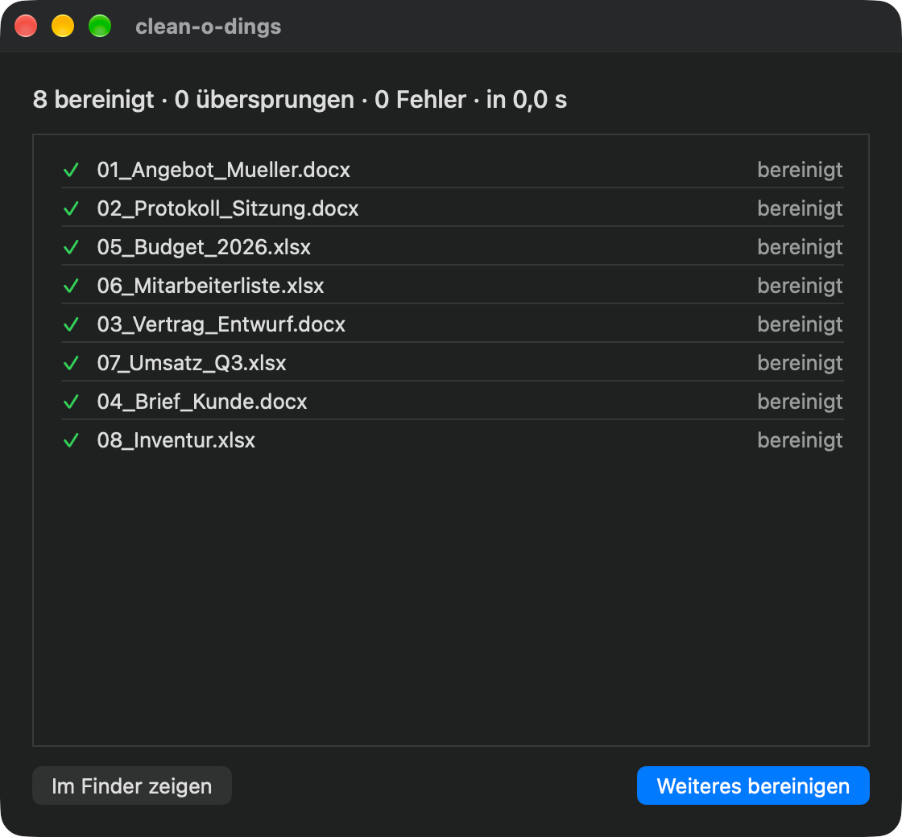

  

# clean-o-dings

[English](README.md) · [Deutsch](README.de.md)

Eine kleine macOS-App, die personenbezogene Metadaten aus Word-, Excel- und PowerPoint-Dateien entfernt, bevor du sie weitergibst. Inhalt, Datumsangaben, Titel und Statistiken bleiben unverändert.

  

## Download

**[Neueste Version herunterladen](https://github.com/fstk/clean-o-dings/releases/latest)** und `clean-o-dings-beta-*.zip` entpacken.

Voraussetzung: macOS 26 oder neuer auf Apple Silicon. Die App ist noch in der Beta.

## Was wird entfernt?

| Teil der Datei | Felder |
|---|---|
| `docProps/core.xml` | Autor (`dc:creator`), Zuletzt geändert von (`cp:lastModifiedBy`) |
| `docProps/app.xml` | `Manager`, `Company`, `LastAuthor` |

Alles andere in der Datei bleibt Byte für Byte identisch, auch die Datumsangaben für Erstellt und Geändert.

Unterstützte Formate: `.docx .docm .dotx .dotm .xlsx .xlsm .xltx .xltm .pptx .pptm .potx .potm`. Die alten Binärformate (`.doc`, `.xls`, `.ppt`) werden nicht unterstützt.

## Benutzung

Dateien oder Ordner auf das Fenster oder das Dock-Symbol ziehen, oder über „Dateien auswählen…“ (⌘O) wählen. Ordner werden samt Unterordnern durchsucht. Die App zeigt pro Datei eine Zeile: bereinigt, übersprungen oder Fehler. Ein Fehler stoppt nie den Rest des Stapels.

**Einstellungen (⌘,)**

- **Sprache:** Deutsch oder Englisch. Ohne Auswahl gilt die Systemsprache.
- **Originale überschreiben** (Standard): Die bereinigten Dateien ersetzen die Originale. Es gibt kein Backup.
- **Aus**: Die Originale bleiben unverändert. Du wählst einen Ausgabeordner, die bereinigten Kopien landen dort mit der kompletten Ordnerstruktur der Eingabe. Wird ein Ordner `Projekt` abgelegt, entsteht `Ausgabeordner/Projekt/…`. Gleichnamige Dateien im Ausgabeordner werden ersetzt.

## Installation

1. Zip entpacken und `clean-o-dings.app` in den Ordner „Programme“ ziehen.
2. Die App ist nur ad-hoc signiert und noch nicht notarisiert, deshalb meldet macOS beim ersten Start eine Warnung. Rechtsklick auf die App, „Öffnen“, oder im Terminal `xattr -cr /Applications/clean-o-dings.app`.

## Datenschutz

clean-o-dings läuft in der macOS App Sandbox und hat keinen Netzwerkzugriff. Die App liest und schreibt nur die Dateien und Ordner, die du ihr gibst. Gespeichert werden nur die Sprache, die Überschreiben-Einstellung und der Pfad des Ausgabeordners.

## Lizenz

[MIT](LICENSE)
