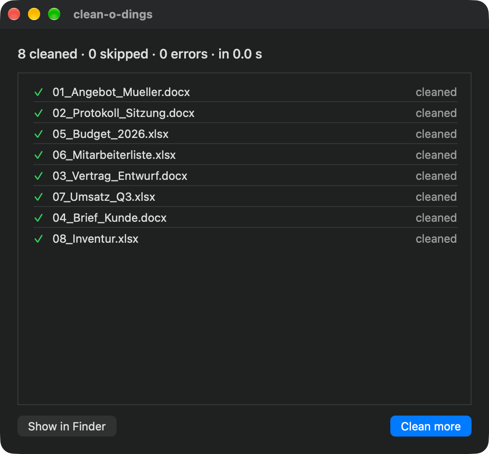

  

# clean-o-dings

[English](README.md) · [Deutsch](README.de.md)

A small macOS app that removes personal metadata from Word, Excel and PowerPoint files before you share them. Content, dates, titles and statistics stay untouched.

  

## Download

**[Download the latest release](https://github.com/fstk/clean-o-dings/releases/latest)** and unzip `clean-o-dings-beta-*.zip`.

Requires macOS 26 or later on Apple Silicon. The app is currently in beta.

## What gets removed

| Part of the file | Fields |
|---|---|
| `docProps/core.xml` | Author (`dc:creator`), Last modified by (`cp:lastModifiedBy`) |
| `docProps/app.xml` | `Manager`, `Company`, `LastAuthor` |

Everything else in the file stays byte-for-byte identical, including created and modified dates.

Supported formats: `.docx .docm .dotx .dotm .xlsx .xlsm .xltx .xltm .pptx .pptm .potx .potm`. The old binary formats (`.doc`, `.xls`, `.ppt`) are not supported.

## Usage

Drop files or folders onto the window or the Dock icon, or choose them with “Choose files…” (⌘O). Folders are searched recursively. The app shows one line per file: cleaned, skipped or error. An error never stops the rest of the batch.

**Settings (⌘,)**

- **Language:** German or English. The default follows your system language.
- **Overwrite originals** (default): the cleaned files replace the originals. There is no backup.
- **Off**: the originals stay untouched. Pick an output folder and the cleaned copies are written there with the complete folder structure of your input. Dropping a folder `Project` creates `<output folder>/Project/…`. Files with the same name in the output folder are replaced.

## Installation

1. Unzip the download and move `clean-o-dings.app` to your Applications folder.
2. The app is signed ad hoc and not notarized yet, so macOS shows a warning on first launch. Right-click the app and choose “Open”, or run `xattr -cr /Applications/clean-o-dings.app` in Terminal.

## Privacy

clean-o-dings runs in the macOS App Sandbox and has no network access. It only reads and writes the files and folders you give it. The only things it stores are the language, the overwrite setting and the path of your output folder.

## License

[MIT](LICENSE)
